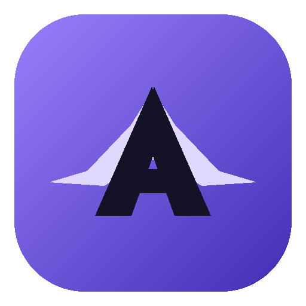
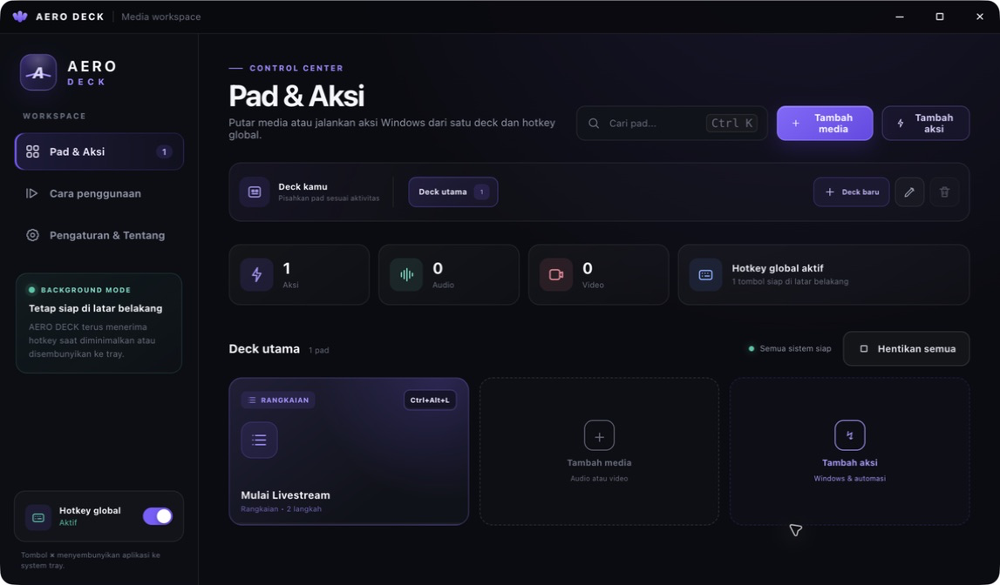
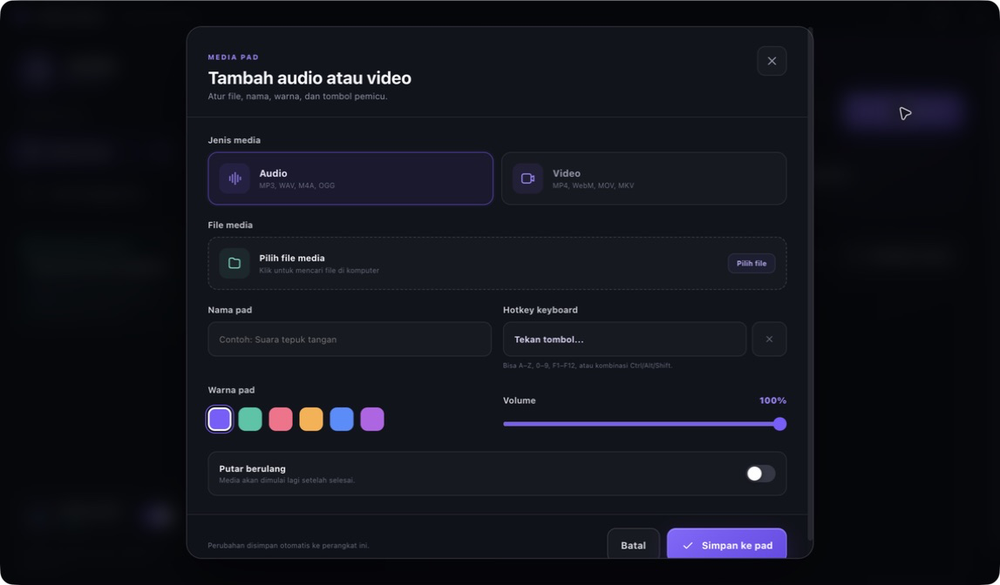

<p align="center">
  
</p>

<h1 align="center">AERO DECK</h1>

<p align="center">
  Soundboard dan video deck desktop untuk Windows.<br>
  Pasangkan audio atau video ke tombol keyboard, lalu putar secara instan dari aplikasi mana pun.
</p>

<p align="center">
  <strong>Alternatif gratis dan open-source bagi pengguna yang ingin fungsi Stream Deck tanpa memakai atau membeli perangkat Elgato.</strong><br>
  Gunakan keyboard yang sudah Anda punya untuk menjalankan audio dan video dengan cepat.
</p>

<p align="center">
  <a href="https://github.com/copszeo/AERO-DECK/actions">
    
  </a>
  <a href="https://github.com/copszeo/AERO-DECK/releases/latest">
    
  </a>
  <a href="#lisensi">
    
  </a>
  
  
  
</p>

<p align="center">
  <a href="https://github.com/copszeo/AERO-DECK/releases/latest"><strong>⬇ Download Latest Release</strong></a>
  ·
  <a href="#mulai-cepat">Mulai cepat</a>
  ·
  <a href="https://github.com/copszeo/AERO-DECK/issues">Laporkan masalah</a>
</p>

---

AERO DECK mengubah keyboard menjadi kumpulan media pad bergaya Stream Deck. Gunakan huruf, angka, `F1`–`F12`, atau kombinasi seperti `Ctrl+Alt+7` untuk memutar suara dan video tanpa harus kembali ke dashboard.

> [!NOTE]
> AERO DECK adalah proyek independen dan tidak berafiliasi, disponsori, atau didukung oleh pihak mana pun, termasuk Elgato maupun Corsair. Nama dan merek dagang terkait tetap menjadi milik pemegangnya masing-masing.

## Pratinjau

| Dashboard media pad | Editor pad |
| --- | --- |
|  |  |

## Fitur utama

- **Pad audio dan video** — satu dashboard untuk suara, musik, klip, dan video.
- **Hotkey global** — picu media dengan huruf, angka, tombol fungsi, atau kombinasi modifier.
- **Mode background dan system tray** — hotkey tetap tersedia saat dashboard disembunyikan.
- **Video player terpisah** — mendukung kontrol video, layar penuh, dan mode selalu di atas.
- **Kontrol per pad** — atur nama, warna, volume, hotkey, dan pemutaran berulang.
- **Pencarian dan drag-and-drop** — temukan pad dengan cepat atau jatuhkan file langsung ke aplikasi.
- **Status yang jelas** — lihat media yang sedang diputar, konflik hotkey, dan file sumber yang hilang.
- **Penyimpanan lokal** — konfigurasi tersimpan di perangkat; file media asli tetap di lokasinya.

## Mulai cepat

### Persyaratan

- Windows 10 atau Windows 11, 64-bit.
- File audio atau video yang tersimpan di drive lokal maupun drive yang selalu tersedia.

### Instalasi

1. Buka halaman [Latest Release](https://github.com/copszeo/AERO-DECK/releases/latest).
2. Unduh installer `AERO-DECK-Setup-<versi>.exe`.
3. Jalankan installer, pilih lokasi pemasangan, lalu buka AERO DECK dari Desktop atau Start Menu.
4. Pilih **Tambah media**, tentukan file, nama pad, volume, dan hotkey.
5. Simpan pad, lalu tekan pad atau hotkey untuk menguji playback.

> [!IMPORTANT]
> Unduh installer hanya dari halaman Releases resmi. Jika Windows SmartScreen menampilkan **Unknown publisher**, periksa kembali sumber unduhan, nama file, dan checksum rilis—jika disediakan—sebelum melanjutkan.

## Hotkey dan system tray

Hotkey global bekerja selama proses AERO DECK masih berjalan, termasuk ketika dashboard tidak terlihat.

- Tombol tunggal seperti `A`, `5`, atau `F8` dapat aktif ketika Anda sedang mengetik atau bekerja di aplikasi lain. Untuk pemakaian umum, kombinasi seperti `Ctrl+Alt+5` lebih aman.
- Windows atau aplikasi lain dapat lebih dahulu memakai sebuah kombinasi. Jika AERO DECK menandai hotkey sebagai bermasalah, pilih kombinasi lain.
- Saat editor atau perekam hotkey terbuka, registrasi global dapat dijeda sementara agar input tidak memicu media.
- Tombol **×** pada dashboard menyembunyikan aplikasi ke system tray; tombol tersebut bukan perintah keluar.
- Gunakan menu tray untuk membuka dashboard, mengaktifkan atau menjeda hotkey global, menghentikan semua media, atau keluar sepenuhnya.
- Untuk sementara mematikan seluruh shortcut tanpa menghapus pemetaan, nonaktifkan toggle **Hotkey global**.

## Format media

AERO DECK menerima ekstensi berikut:

| Jenis | Ekstensi |
| --- | --- |
| Audio | `.mp3`, `.wav`, `.ogg`, `.m4a`, `.aac`, `.flac`, `.opus` |
| Video | `.mp4`, `.webm`, `.mov`, `.mkv`, `.m4v`, `.avi` |

Ekstensi file tidak menjamin codec di dalamnya dapat diputar oleh Chromium/Electron. Untuk kompatibilitas terbaik, gunakan:

- Audio: MP3 atau WAV.
- Video: MP4 dengan H.264/AAC, atau WebM dengan VP8/VP9 dan Opus.

Jika sebuah file diterima tetapi gagal diputar, konversikan file ke salah satu kombinasi di atas lalu pilih kembali file tersebut pada editor pad.

## Penggunaan bersama OBS, Discord, dan aplikasi streaming

AERO DECK mengirim audio ke perangkat output Windows yang sedang aktif. Agar suara masuk sebagai mikrofon Discord, voice chat, atau mixer streaming, gunakan perangkat audio virtual dan atur routing audio Windows sesuai kebutuhan.

Untuk video, tambahkan **Window Capture** di OBS dan pilih jendela **AERO DECK Player**.

## Pemecahan masalah

| Masalah | Yang perlu diperiksa |
| --- | --- |
| Hotkey tidak merespons | Pastikan **Hotkey global** aktif, editor sudah ditutup, dan kombinasi tidak dipakai Windows atau aplikasi lain. Coba kombinasi dengan `Ctrl` atau `Alt`. |
| Hotkey mengganggu saat mengetik | Hindari hotkey satu tombol atau jeda hotkey global dari dashboard maupun menu tray. |
| Tidak ada suara | Periksa volume pad, volume Windows, perangkat output aktif, dan Volume Mixer. |
| Video gagal diputar | Gunakan MP4 H.264/AAC atau WebM, lalu pastikan file dapat diputar di aplikasi lain. |
| Pad menampilkan **File hilang** | Edit pad dan pilih kembali file sumber. AERO DECK menyimpan referensi lokasi, bukan salinan media. |
| Dashboard menghilang setelah menekan **×** | Aplikasi sedang berjalan di system tray. Klik ikon AERO DECK untuk membukanya kembali. |
| Suara tidak masuk ke Discord/OBS | Atur perangkat audio virtual sebagai rute output/input; AERO DECK tidak membuat perangkat mikrofon virtual. |

Jika masalah tetap terjadi, buka [GitHub Issue](https://github.com/copszeo/AERO-DECK/issues/new) dan sertakan versi AERO DECK, versi Windows, langkah reproduksi, serta format media yang digunakan. Jangan unggah media pribadi atau data sensitif.

## Privasi dan keamanan

- AERO DECK dirancang **local-first**: tidak memerlukan akun dan tidak mengunggah media melalui fitur aplikasinya.
- File media tidak disalin, dimodifikasi, atau dihapus. Aplikasi menyimpan referensi path dan konfigurasi pad di direktori data aplikasi pengguna Windows.
- Hanya shortcut yang dipilih pengguna yang didaftarkan sebagai global shortcut; aplikasi tidak memerlukan perekaman seluruh input keyboard.
- Renderer Electron menggunakan context isolation dan sandbox, dengan akses sistem dibatasi melalui API preload.
- Selalu ambil installer dari [Releases resmi](https://github.com/copszeo/AERO-DECK/releases) dan cocokkan checksum jika tersedia.

Untuk melaporkan kerentanan, gunakan [private vulnerability report](https://github.com/copszeo/AERO-DECK/security/advisories/new). Hindari memublikasikan detail eksploitasi pada issue umum sebelum pemelihara sempat menanganinya.

## Pengembangan

### Menjalankan dari source

Prasyarat: Git, Node.js versi LTS terbaru, dan npm.

```bash
git clone https://github.com/copszeo/AERO-DECK.git
cd AERO-DECK
npm ci
npm start
```

### Perintah proyek

| Perintah | Kegunaan |
| --- | --- |
| `npm start` | Menjalankan aplikasi dalam mode pengembangan. |
| `npm test` | Menjalankan unit test dengan Node.js test runner. |
| `npm run check` | Memeriksa sintaks source utama, preload, dan renderer. |
| `npm run pack:win` | Membuat build Windows tanpa installer. |
| `npm run dist:win` | Membuat installer NSIS Windows x64 di direktori `release/`. |

Build distribusi Windows paling konsisten bila dijalankan pada Windows atau runner CI Windows.

### Struktur proyek

```text
assets/          Ikon dan aset aplikasi
src/main/        Lifecycle Electron, hotkey, tray, media, queue, dan penyimpanan
src/preload/     Jembatan API terisolasi untuk dashboard dan player
src/renderer/    Dashboard serta UI player audio/video
test/            Unit test hotkey, media, penyimpanan, dan playback queue
```

## Roadmap

Roadmap berikut adalah arah pengembangan dan bukan janji tanggal rilis:

- [ ] Profil dan beberapa deck untuk skenario berbeda.
- [ ] Pengaturan ukuran grid serta drag-and-drop untuk mengurutkan pad.
- [ ] Pilihan perangkat output audio dan monitor tujuan video.
- [ ] Mode playback tambahan: toggle, restart, stop media lain, dan fade.
- [ ] Impor, ekspor, dan backup konfigurasi.
- [ ] Peningkatan aksesibilitas keyboard, screen reader, serta high contrast.
- [ ] Lokalisasi antarmuka tambahan.

Lihat [Issues](https://github.com/copszeo/AERO-DECK/issues) untuk diskusi dan progres terbaru.

## Berkontribusi

Kontribusi bug fix, dokumentasi, pengujian, dan peningkatan UX sangat diterima.

1. Fork repository dan buat branch dari `main`.
2. Lakukan perubahan dengan scope yang jelas.
3. Jalankan `npm run check` dan `npm test`.
4. Buat pull request yang menjelaskan masalah, solusi, serta cara verifikasinya.

Untuk perubahan besar, buka issue terlebih dahulu agar arah implementasi dapat disepakati sebelum banyak pekerjaan dilakukan.

## Lisensi

AERO DECK didistribusikan di bawah [lisensi MIT](LICENSE).
